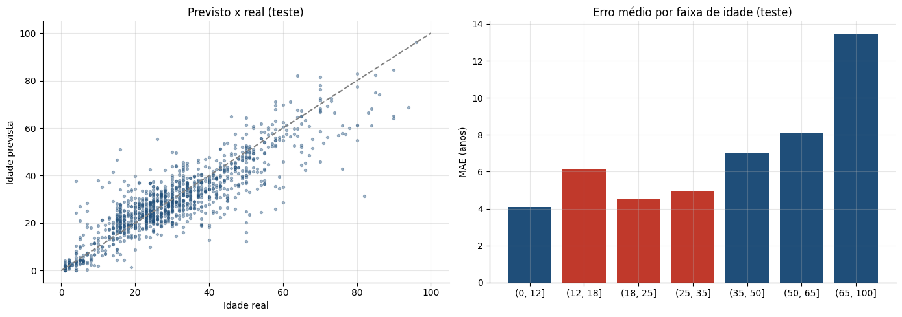

# Estimativa de Idade por Imagem para Evitar a Venda de Álcool a Menores

> **Resultado:** erro absoluto médio (MAE) de **5,96 anos no conjunto de teste**, 55% menor que o de uma linha de base, com transfer learning sobre a ResNet50. Pedir documento quando a idade estimada for menor que 25 anos identificaria **89% dos menores**, abordando 25% dos adultos.

## Problema de negócio

Estabelecimentos comerciais precisam verificar a idade dos clientes na venda de bebidas alcoólicas. A proposta é um modelo de visão computacional que estime a idade de uma pessoa a partir de uma foto do rosto, apoiando essa verificação no momento da compra.

## Dados

- **7.591 fotos de rostos** com a idade real de cada pessoa, de 1 a 100 anos (19,8% de menores de 18)
- Subconjunto da base pública de pesquisa APPA-REAL (Agustsson et al., 2017, ChaLearn LAP), de uso exclusivo para pesquisa e estudo
- Divisão estratificada por idade: 70% treino, 15% validação e 15% teste

## Abordagem

1. **Pipeline de imagens com `tf.data`**, com o pré-processamento oficial da ResNet50 e aumento de dados no treino (espelhamento, rotação, zoom e contraste).
2. **Transfer learning:** ResNet50 pré-treinada no ImageNet, ajustada por inteiro, com dropout e uma saída `Dense(1)`.
3. **Treinamento em GPU** com early stopping e redução automática da taxa de aprendizado.
4. **Avaliação no conjunto de teste**, comparada a uma linha de base e detalhada por faixa de idade.
5. **Simulação de política:** a partir de qual idade estimada o atendente deve pedir documento.

## Resultados

| Avaliação | MAE |
|---|---|
| Treino | 3,90 anos |
| Validação | 6,05 anos |
| **Teste** | **5,96 anos** |
| Linha de base (sempre a idade média) | 13,29 anos |

| Pedir documento se a idade estimada for menor que | Menores identificados | Adultos abordados |
|---|---|---|
| 18 anos | 63% | 4% |
| 22 anos | 82% | 14% |
| **25 anos** | **89%** | **25%** |
| 28 anos | 94% | 36% |

- O erro é menor entre crianças e jovens adultos (4 a 5 anos) e chega a 13,5 anos acima dos 65, faixa com menos fotos.
- Na faixa de 12 a 18 anos, a mais importante para o negócio, o erro médio é de 6,1 anos.

## Recomendação

Usar o modelo como **apoio ao atendente**, pedindo documento quando a idade estimada for menor que 25 anos, e nunca como decisão automática. A foto do rosto é um **dado biométrico**, considerado sensível pela LGPD (Art. 5º, II): qualquer uso real exige base legal, transparência com os clientes e não armazenar as imagens além do necessário.

## Correções desta versão

A primeira versão deste projeto tinha uma camada de saída com 12 neurônios (`Dense(12)`), foi avaliada só no conjunto de validação e apresentava overfitting (2,1 anos de erro no treino contra 5,8 na validação). Esta versão corrige a saída para `Dense(1)`, avalia em um conjunto de teste separado e reduz o overfitting com aumento de dados, dropout e early stopping: a diferença entre treino e validação caiu de 3,7 para 2,2 anos. O notebook original foi mantido na pasta como registro.

## Próximos passos

- Coletar mais fotos de adolescentes e de idosos
- Testar arquiteturas mais recentes, como a EfficientNet
- Avaliar se o erro é parecido entre grupos de pessoas diferentes

## Tecnologias

Python · TensorFlow · Keras · ResNet50 · tf.data · Pandas · Matplotlib · Google Colab (GPU)

## Como executar

Clique no botão **"Abrir no Colab"** acima, ative a GPU (Ambiente de execução → Alterar o tipo de ambiente de execução → GPU T4) e execute todas as células. O notebook baixa as fotos de uma cópia pública do conjunto; as imagens não são redistribuídas neste repositório. O treinamento leva cerca de 25 minutos.

## 🔗 Contato

Email: gabrieldeoliver1@gmail.com
