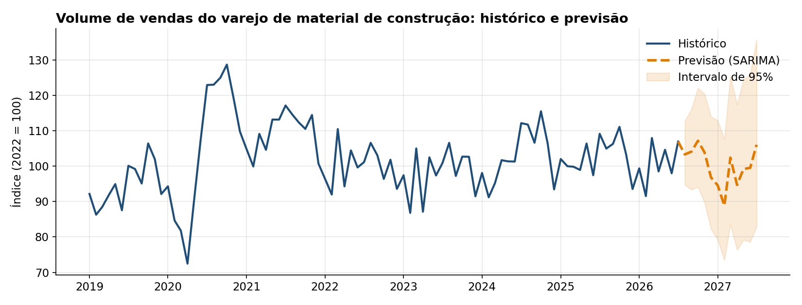

# Previsão de Vendas do Varejo de Material de Construção

> **Resultado:** previsão dos próximos 12 meses com erro médio (MAPE) de **3,37%**, **25% menor** que a linha de base, usando SARIMA com variáveis de calendário, validado em 6 janelas de teste sem uso de dados do futuro.

[](https://colab.research.google.com/github/gabrieldeoliver1/Projetos/blob/main/Projeto_17/17.previsao_de_vendas_do_varejo_de_material_de_construcao.ipynb)



## Problema de negócio

Para um home center, saber quanto o mercado vai vender nos próximos meses orienta compras, estoque, escala de equipes e metas. Comprar demais imobiliza capital; comprar de menos significa ruptura e venda perdida. Este projeto prevê o volume de vendas do varejo de material de construção no Brasil para os próximos 12 meses, a partir de dados públicos do IBGE.

## Dados

- **Fonte:** IBGE, Pesquisa Mensal de Comércio, [tabela 8883](https://sidra.ibge.gov.br/tabela/8883)
- **Variável:** índice de volume de vendas de material de construção (2022 = 100), sem ajuste sazonal
- **Período:** janeiro de 2003 a julho de 2026, 283 meses, sem lacunas

## Abordagem

1. **Preparação:** conversão da tabela do IBGE, que vem em formato largo (um mês por coluna), para uma série mensal.
2. **Análise exploratória:** tendência, choques, decomposição STL, perfil sazonal e efeito do calendário.
3. **Modelos:** sazonal ingênuo (linha de base), Holt-Winters, SARIMA com e sem variáveis de calendário, LightGBM e combinação de modelos.
4. **Validação por origem móvel:** em 6 pontos de corte semestrais, de jan/2023 a jul/2025, cada modelo é treinado só com o passado e prevê os 12 meses seguintes. A ordem do SARIMA é escolhida pelo AIC usando apenas dados anteriores ao primeiro corte.
5. **Previsão final** dos próximos 12 meses, com intervalo de confiança de 95%.

## Principais descobertas

- **Sazonalidade forte:** de julho a novembro as vendas ficam de 3% a 7% acima da tendência; fevereiro é o mês mais fraco, cerca de 11% abaixo.
- **O calendário importa:** cada dia útil a mais no mês soma cerca de **3,2%** ao volume de vendas, e cada sábado a mais, cerca de **1,5%**.
- **Choques dominam a história:** a recessão de 2015-2016 e o boom de reformas na pandemia, com o pico histórico em outubro de 2020.
- **O modelo mais sofisticado não venceu:** o LightGBM ficou pior que a linha de base, porque 283 observações mensais são poucas para um modelo de árvores.

## Resultados

| Modelo | MAPE | RMSE | Ganho sobre a linha de base |
|---|---|---|---|
| **SARIMA com calendário** | **3,37%** | **4,30** | **25%** |
| Combinação (média de 3 modelos) | 3,40% | 4,48 | 24% |
| Holt-Winters | 3,61% | 4,48 | 20% |
| SARIMA sem calendário | 3,66% | 4,57 | 18% |
| Sazonal ingênuo (linha de base) | 4,48% | 5,66 | – |
| LightGBM | 5,61% | 6,93 | –25% |

O modelo final é um **SARIMA(1,1,0)x(1,1,1,12)** sobre o logaritmo da série, com dias úteis e sábados como variáveis externas. A previsão aponta para uma **leve retração, de cerca de 2%** nos próximos 12 meses, mantendo a sazonalidade.

## Próximos passos

- Incluir variáveis econômicas, como juros, crédito imobiliário e emprego, para antecipar choques
- Considerar os feriados nacionais no cálculo de dias úteis
- Automatizar a atualização mensal da previsão, assim que o IBGE divulgar um novo dado
- Publicar um painel interativo com a previsão

## Tecnologias

Python · Pandas · NumPy · Statsmodels · LightGBM · Matplotlib · Jupyter Notebook

## Como executar

**No Google Colab:** clique no botão "Abrir no Colab" acima e rode todas as células. O notebook baixa os dados do próprio repositório.

**Localmente:**

```bash
git clone https://github.com/gabrieldeoliver1/Projetos.git
cd Projetos/Projeto_17
pip install pandas numpy matplotlib statsmodels lightgbm jupyter
jupyter notebook
```

Os dados (`tabela8883.csv`) são públicos e estão incluídos nesta pasta.

## 🔗 Contato

[](https://www.linkedin.com/in/gabrieldeoliver1/)

Email: gabrieldeoliver1@gmail.com
