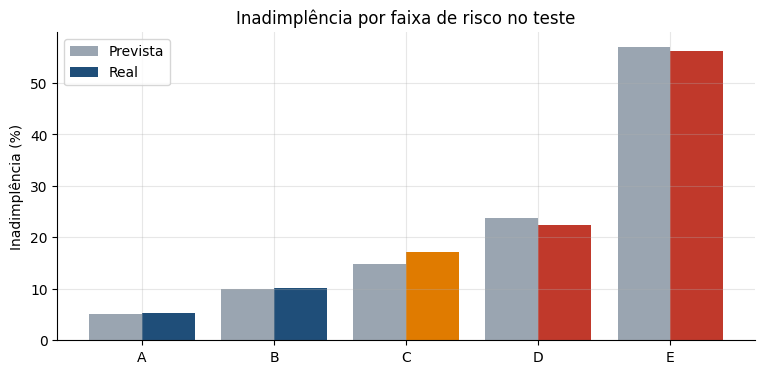

# Modelo de Risco de Crédito: Probabilidade de Inadimplência em Cartão de Crédito

> **Resultado:** modelo LightGBM com **AUC de 0,78, Gini de 0,56 e KS de 0,43** no teste, bem calibrado e sem viés entre grupos. Na simulação de política, restringir o crédito dos 20% de maior risco reduz a inadimplência da carteira de **22,1% para 13,7%** e evita **53% do saldo em risco**.

[](https://colab.research.google.com/github/gabrieldeoliver1/Projetos/blob/main/Projeto_18/18.modelo_de_risco_de_credito.ipynb)



> 🚀 **Este modelo está em produção como API:** [api-risco-de-credito](https://github.com/gabrieldeoliver1/api-risco-de-credito), com FastAPI, Docker, testes automatizados e integração contínua.

## Problema de negócio

Toda vez que um banco concede ou mantém crédito, assume o risco de não receber. Para gerenciar esse risco, os bancos estimam a probabilidade de inadimplência (PD) de cada cliente e a usam para decidir quem aprovar, qual limite oferecer e onde concentrar a cobrança. Este projeto constrói esse modelo para clientes de cartão de crédito e o transforma em uma política de crédito.

## Dados

- **Default of Credit Card Clients:** dados reais de **30.000 clientes** de cartão de crédito de um banco de Taiwan, de abril a setembro de 2005
- Limite, perfil, situação de pagamento, faturas e pagamentos dos últimos 6 meses
- Inadimplência de 22,1% no mês seguinte
- Fonte: Yeh, I. C., & Lien, C. H. (2009), *Expert Systems with Applications*, 36(2). UCI Machine Learning Repository, licença CC BY 4.0

## Abordagem

1. **Preparação e análise exploratória:** correção de categorias não documentadas, inadimplência por histórico de pagamento, limite, idade e perfil, e correlação entre variáveis.
2. **Engenharia de variáveis:** meses em atraso, maior atraso, utilização do limite, taxa de pagamento, variação da fatura e pagamento médio em relação ao limite.
3. **Seleção de variáveis com WoE e IV**, as ferramentas padrão do mercado de crédito.
4. **Scorecard:** Regressão Logística sobre o WoE, com filtro de correlação e de sinal dos coeficientes, convertida em pontos (600 pontos para chance de 50:1 e PDO de 20).
5. **LightGBM** com early stopping.
6. **Avaliação** com AUC, Gini, KS e calibração, usando o conjunto de teste uma única vez.
7. **Explicabilidade com SHAP.**
8. **Faixas de risco (A a E) e simulação de política de crédito.**
9. **Monitoramento:** estabilidade com PSI e auditoria de equidade.

**Sexo e estado civil não foram usados no modelo**, para evitar discriminação; essas variáveis serviram apenas para a auditoria de equidade.

## Resultados

| Modelo | AUC | Gini | KS | Brier |
|---|---|---|---|---|
| Scorecard (Regressão Logística + WoE) | 0,763 | 0,526 | 0,395 | 0,139 |
| **LightGBM** | **0,782** | **0,564** | **0,430** | **0,134** |

*Métricas no conjunto de teste.*

| Faixa | Clientes | Inadimplência prevista | Inadimplência real |
|---|---|---|---|
| A | 20% | 5,1% | 5,2% |
| B | 20% | 9,9% | 10,1% |
| C | 20% | 14,9% | 17,1% |
| D | 20% | 23,8% | 22,4% |
| E | 20% | 57,0% | 56,3% |

## Principais descobertas

- O **histórico de pagamento** é o principal sinal de risco: a inadimplência sobe de 12%, para quem nunca atrasou, até 70%, para quem atrasou nos 6 meses.
- O **limite alto reduz o risco** e a **utilização alta do limite aumenta**; os valores das faturas, sozinhos, quase não têm poder preditivo.
- A **faixa E** concentra metade dos inadimplentes.
- Restringir os **20% de maior risco** evita 50,5% dos inadimplentes e 53,2% do saldo em risco, afetando 11,3% dos bons clientes.
- O modelo é **estável** (PSI de 0,002) e **igualmente calibrado** para homens e mulheres.

## Próximos passos

- Estimar a LGD e a EAD para calcular a perda esperada completa
- Definir o ponto de corte com a margem dos bons clientes e a perda dos maus
- Incluir dados de renda e de birôs de crédito
- Retreinar com dados locais e recentes antes de aplicar em outro contexto

## Tecnologias

Python · Pandas · NumPy · Scikit-learn · LightGBM · SHAP · Matplotlib · Seaborn · Jupyter Notebook

## Como executar

**No Google Colab:** clique no botão "Abrir no Colab" acima e rode todas as células. O notebook baixa os dados do próprio repositório.

**Localmente:**

```bash
git clone https://github.com/gabrieldeoliver1/Projetos.git
cd Projetos/Projeto_18
pip install pandas numpy matplotlib seaborn scikit-learn lightgbm shap jupyter
jupyter notebook
```

Os dados (`default_of_credit_card_clients.csv`) são públicos e estão incluídos nesta pasta.

## 🔗 Contato

[](https://www.linkedin.com/in/gabrieldeoliver1/)

Email: gabrieldeoliver1@gmail.com
