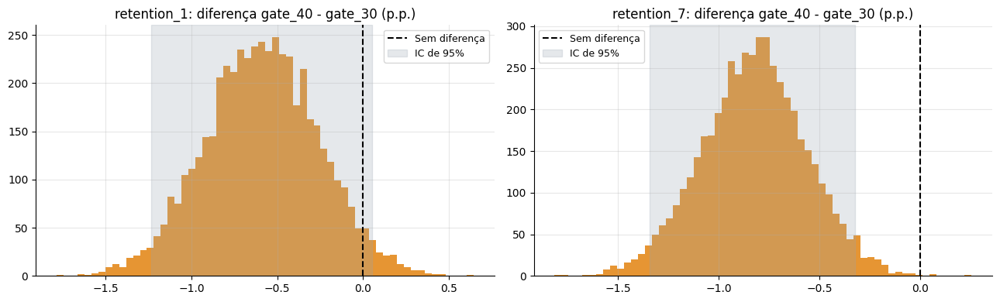

# Teste A/B: o Impacto de Mover o Portão de Progresso no Jogo Cookie Cats

> **Resultado:** mover o primeiro portão do nível 30 para o 40 **reduziu a retenção de 7 dias em 0,82 ponto percentual** (de 19,02% para 18,20%, valor-p de 0,0016), sem aumentar o engajamento. A probabilidade bayesiana de o portão no nível 30 ser melhor é de **99,9%**. Recomendação: manter o portão no nível 30.

[](https://colab.research.google.com/github/gabrieldeoliver1/Projetos/blob/main/Projeto_19/19.teste_ab_cookie_cats.ipynb)



## Problema de negócio

No jogo para celular Cookie Cats, o jogador encontra portões que o obrigam a esperar ou a fazer uma compra para continuar. A empresa testou mover o primeiro portão do **nível 30** para o **nível 40** e precisa decidir se a mudança melhora ou piora a retenção dos jogadores.

## Dados

- **90.189 jogadores**, divididos aleatoriamente entre os grupos gate_30 (controle) e gate_40 (tratamento)
- Métricas: retenção de 1 dia, **retenção de 7 dias (principal)** e rodadas jogadas nos primeiros 14 dias
- Fonte: dados do experimento da Tactile Entertainment, disponibilizados publicamente no projeto *Mobile Games A/B Testing with Cookie Cats*

## Abordagem

1. **Validação do experimento:** teste de SRM (Sample Ratio Mismatch) para checar a divisão dos grupos.
2. **Análise exploratória:** distribuição das rodadas, remoção de um registro impossível (49.854 rodadas em 14 dias) e retenção por grupo.
3. **Testes de hipóteses:** teste Z para duas proporções, com intervalo de confiança da diferença.
4. **Bootstrap** com 5.000 reamostragens.
5. **Engajamento:** teste de Mann-Whitney e bootstrap da média e da mediana, além da **correção de Holm** para múltiplos testes.
6. **Poder estatístico e MDE** (efeito mínimo detectável).
7. **Abordagem bayesiana:** distribuições Beta, probabilidade de cada versão ser a melhor e perda esperada.
8. **Validação do método com 1.000 testes A/A.**
9. **Análise exploratória por segmento**, com a ressalva do viés de variáveis posteriores ao tratamento.

## Resultados

| Métrica | gate_30 | gate_40 | Diferença | Valor-p | Valor-p ajustado (Holm) |
|---|---|---|---|---|---|
| **Retenção de 7 dias** | **19,02%** | **18,20%** | **-0,82 p.p.** | **0,0016** | **0,0048** |
| Retenção de 1 dia | 44,82% | 44,23% | -0,59 p.p. | 0,074 | 0,102 |
| Rodadas jogadas (média) | 51,3 | 51,3 | 0,0 | 0,051 | 0,102 |

- **Bayesiano:** 99,9% de probabilidade de o gate_30 reter mais jogadores em 7 dias; escolher o gate_40 teria perda esperada de 0,82 ponto percentual.
- **Poder:** o teste detectava efeitos a partir de 0,73 ponto percentual, então tinha amostra suficiente para o efeito observado.
- **Testes A/A:** 4,7% de falsos positivos, perto dos 5% esperados.
- **SRM:** o desequilíbrio entre os grupos (valor-p de 0,0086) é um alerta que precisaria ser investigado antes da decisão final.

## Recomendação

**Manter o portão no nível 30.** A mudança não aumenta o engajamento e reduz a retenção de 7 dias: a cada 100 mil novos jogadores, seriam cerca de 820 jogadores a menos ativos depois de uma semana.

## Próximos passos

- Investigar a causa do desequilíbrio entre os grupos (SRM)
- Medir o impacto na receita, já que os portões também geram compras
- Testar outras posições para o portão, definindo o efeito mínimo relevante e a amostra antes do teste

## Tecnologias

Python · Pandas · NumPy · SciPy · Statsmodels · Matplotlib · Jupyter Notebook

## Como executar

**No Google Colab:** clique no botão "Abrir no Colab" acima e rode todas as células. O notebook baixa os dados do próprio repositório.

**Localmente:**

```bash
git clone https://github.com/gabrieldeoliver1/Projetos.git
cd Projetos/Projeto_19
pip install pandas numpy matplotlib scipy statsmodels jupyter
jupyter notebook
```

Os dados (`cookie_cats.csv`) estão incluídos nesta pasta.

## 🔗 Contato

[](https://www.linkedin.com/in/gabrieldeoliver1/)

Email: gabrieldeoliver1@gmail.com
