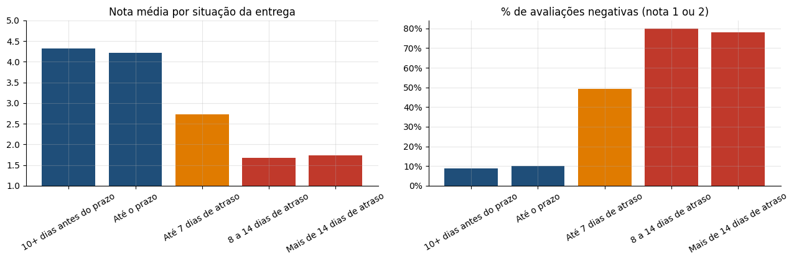

# Análise de E-commerce com SQL: Vendas, Logística, Retenção e Clientes da Olist

> **Resultado:** análise de cerca de **100 mil pedidos reais** com SQL (JOINs entre 8 tabelas, CTEs e funções de janela). Os principais achados: **97% dos clientes compram uma única vez**, entregas com mais de 7 dias de atraso derrubam a nota média para **menos de 2**, e dois segmentos RFM concentram **68% da receita**.

[](https://colab.research.google.com/github/gabrieldeoliver1/Projetos/blob/main/Projeto_20/20.analise_de_ecommerce_com_sql.ipynb)



## Problema de negócio

A Olist conecta pequenos e médios lojistas aos grandes marketplaces brasileiros. Este projeto responde, com SQL, às perguntas que a liderança de um e-commerce faz no dia a dia: como as vendas evoluem, onde está a receita, o que afeta a satisfação, se os clientes voltam a comprar e como segmentá-los.

## Dados

- *Brazilian E-Commerce Public Dataset by Olist*: dados reais e anonimizados de **99.441 pedidos** feitos entre 2016 e 2018, licença CC BY-NC-SA 4.0
- **8 tabelas relacionadas:** pedidos, itens, clientes, pagamentos, avaliações, produtos, vendedores e categorias
- As tabelas são carregadas em um banco **SQLite**, e toda a análise é feita com consultas SQL

## Técnicas de SQL utilizadas

| Técnica | Onde foi usada |
|---|---|
| `JOIN` entre várias tabelas | Receita, logística, vendedores e RFM |
| CTEs (`WITH`) | Nota média por pedido, coortes, desempenho de vendedores e RFM |
| `LAG()` | Crescimento mensal da receita |
| `AVG() OVER (ROWS BETWEEN ...)` | Média móvel de 3 meses |
| `SUM() OVER (ORDER BY ...)` | Participação acumulada (Pareto das categorias) |
| `RANK() OVER (PARTITION BY ...)` | Ranking de vendedores por estado |
| `NTILE()` | Notas de recência e valor na segmentação RFM |
| `CASE` | Faixas de atraso, parcelas e segmentos |
| Funções de data (`strftime`, `julianday`) | Prazos de entrega e análise de coorte |

## Principais descobertas

- **Tamanho do negócio:** R$ 15,4 milhões em 96 mil pedidos entregues, com ticket médio de R$ 160. O maior mês foi novembro de 2017 (Black Friday), e a receita se estabilizou em 2018.
- **Pareto:** 18 das 74 categorias concentram 80% da receita.
- **Frete:** em Roraima, equivale a 28% do preço dos produtos; em São Paulo, a 14%.
- **Logística e satisfação:** a nota média cai de 4,3 para 1,7 quando o atraso passa de 7 dias, e cerca de 80% dessas avaliações são negativas. **Alagoas** é o estado com mais atrasos (21% dos pedidos).
- **Retenção:** 97% dos clientes compram uma única vez, e a retenção no primeiro mês é de menos de 0,5%.
- **Vendedores:** 16 vendedores estão entre os que mais faturam, mas têm nota abaixo de 3,8 e atrasam mais.
- **Segmentação RFM:** os segmentos "Novos de alto valor" e "Alto valor em risco" somam 37% dos clientes e 68% da receita.

## Recomendações

1. **Retenção é a prioridade:** ações de segunda compra e de reativação para os segmentos de alto valor, medidas com testes A/B.
2. **Logística no Nordeste:** atacar os atrasos, que derrubam a satisfação.
3. **Frete regional:** parcerias logísticas ou vendedores locais para crescer fora do Sudeste.
4. **Gestão de vendedores:** acompanhar os vendedores com alta receita e nota baixa.

## Tecnologias

SQL (SQLite) · Python · Pandas · Matplotlib · Seaborn · Jupyter Notebook

## Como executar

**No Google Colab:** clique no botão "Abrir no Colab" acima e rode todas as células. O notebook baixa os dados do próprio repositório e cria o banco automaticamente.

**Localmente:**

```bash
git clone https://github.com/gabrieldeoliver1/Projetos.git
cd Projetos/Projeto_20
pip install pandas matplotlib seaborn jupyter
jupyter notebook
```

Os dados estão compactados em `olist.zip`, nesta pasta.

## 🔗 Contato

[](https://www.linkedin.com/in/gabrieldeoliver1/)

Email: gabrieldeoliver1@gmail.com
