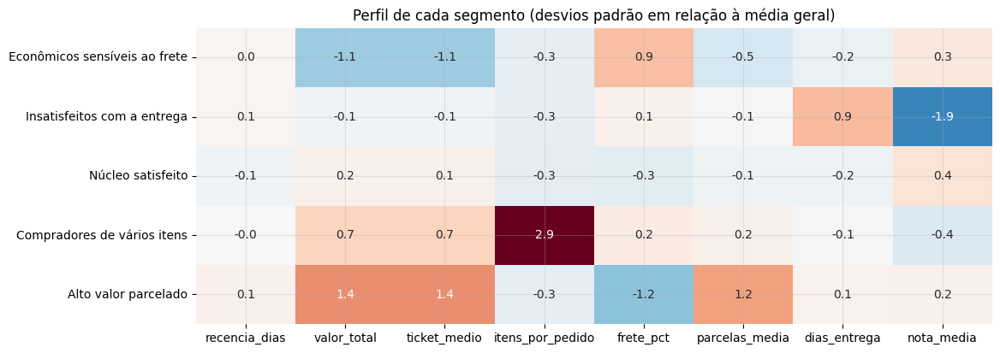

# Segmentação de Clientes com Clustering: Perfis de Compra no E-commerce da Olist

> **Resultado:** 93 mil clientes divididos em **5 segmentos estáveis** (ARI de 0,97) com K-means. O segmento **Alto valor parcelado** tem 15% dos clientes e **40% da receita**, e o clustering revelou um grupo que a segmentação RFM não enxerga: **11% de clientes insatisfeitos com a entrega**, com nota média de 1,7. Uma árvore de decisão traduz os segmentos em **regras simples, com 85% de acerto**.

[](https://colab.research.google.com/github/gabrieldeoliver1/Projetos/blob/main/Projeto_21/21.segmentacao_de_clientes_com_clustering.ipynb)



## Problema de negócio

No [Projeto 20](../Projeto_20), a segmentação RFM com regras fixas mostrou quem compra mais e há quanto tempo. Mas ela não explica **como** cada cliente compra nem **que experiência** ele teve. Este projeto usa aprendizado não supervisionado para descobrir grupos de comportamento e transformá-los em personas com ações de marketing.

## Dados

- *Brazilian E-Commerce Public Dataset by Olist*, a mesma base do Projeto 20, licença CC BY-NC-SA 4.0
- **93.358 clientes únicos** com pedidos entregues
- 8 variáveis por cliente: recência, valor total, ticket médio, itens por pedido, frete como % do preço, parcelas, prazo de entrega e nota média

## Abordagem

1. **Perfil de cada cliente** a partir de 6 tabelas da Olist.
2. **Preparação:** winsorização, logaritmo nas variáveis assimétricas e padronização.
3. **Escolha do número de grupos** com o método do cotovelo, silhouette, Davies-Bouldin e um **teste de estabilidade** com sementes diferentes.
4. **K-means** com 5 grupos e validação da estabilidade.
5. **Personas:** perfil de cada segmento em valores reais, região e categorias mais compradas.
6. **Regras simples** com uma árvore de decisão, para uso em ferramentas de marketing.
7. **Comparação com a segmentação RFM.**
8. **Plano de ação** por segmento.

## Por que 5 grupos

| k | Silhouette | Estabilidade (ARI médio) |
|---|---|---|
| 3 | 0,23 | 1,00 |
| 4 | 0,22 | 0,68 (instável) |
| **5** | **0,18** | **0,99** |
| 6 | 0,17 | 0,96 |
| 7 | 0,17 | 0,65 (instável) |

As opções de 4 e 7 grupos mudam de uma execução para outra. Entre as estáveis, 5 grupos separam perfis com ações claramente diferentes.

## Os 5 segmentos

| Segmento | % clientes | % receita | Características | Ação principal |
|---|---|---|---|---|
| **Alto valor parcelado** | 15% | **40%** | Ticket de R$ 296, cerca de 6 parcelas | Parcelamento sem juros e datas comemorativas |
| **Núcleo satisfeito** | 35% | 28% | Ticket de R$ 119, nota 4,7 | Indicação e cupom de segunda compra |
| **Compradores de vários itens** | 9% | 14% | 2,4 itens por pedido, móveis e decoração | Kits e revisão da entrega de pedidos grandes |
| **Econômicos sensíveis ao frete** | 29% | 9% | Ticket de R$ 48, frete de 42% do preço | Frete grátis acima de um valor mínimo |
| **Insatisfeitos com a entrega** | 11% | 8% | Nota 1,7, entrega em 19 dias | Contato proativo e prioridade logística |

## Principais descobertas

- **15% dos clientes geram 40% da receita**, e o parcelamento é o que viabiliza esse ticket.
- O segmento **Insatisfeitos com a entrega** aparece em todos os grupos RFM: só o clustering, que considera a experiência do cliente, consegue identificá-lo.
- As regras da árvore de decisão (por exemplo, "mais de 1,6 item por pedido" para os compradores de vários itens) permitem usar os segmentos sem depender do modelo.

## Tecnologias

Python · Pandas · NumPy · Scikit-learn (K-means, PCA, árvore de decisão) · Matplotlib · Seaborn · Jupyter Notebook

## Como executar

**No Google Colab:** clique no botão "Abrir no Colab" acima e rode todas as células. O notebook baixa os dados da pasta do Projeto 20.

**Localmente:**

```bash
git clone https://github.com/gabrieldeoliver1/Projetos.git
cd Projetos/Projeto_21
pip install pandas numpy matplotlib seaborn scikit-learn jupyter
jupyter notebook
```

## 🔗 Contato

[](https://www.linkedin.com/in/gabrieldeoliver1/)

Email: gabrieldeoliver1@gmail.com
