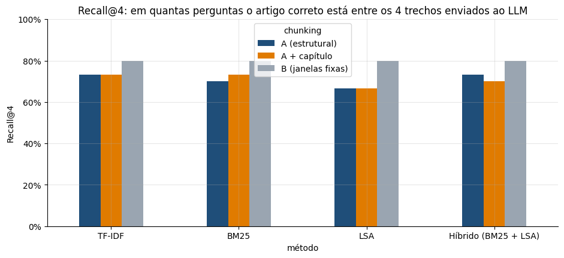

# Assistente de Perguntas sobre a LGPD com RAG e IA Generativa

> **Resultado:** assistente que busca os artigos relevantes da LGPD e usa um LLM para responder **citando a fonte**. Cada etapa é avaliada com perguntas de resposta conhecida: com um glossário que traduz palavras do dia a dia para os termos da lei, o artigo correto passou a estar entre os 4 trechos enviados ao LLM em **80% das perguntas novas, contra 50%** sem ele.

[](https://colab.research.google.com/github/gabrieldeoliver1/Projetos/blob/main/Projeto_22/22.assistente_lgpd_com_rag.ipynb)



## Problema de negócio

Empresas e órgãos públicos têm dúvidas constantes sobre a LGPD, e os LLMs respondem com fluência, mas podem **inventar artigos de lei** com total confiança. A técnica **RAG** (*Retrieval-Augmented Generation*) resolve isso: primeiro busca os trechos da lei que respondem à pergunta e depois pede ao LLM que responda usando apenas esses trechos, citando os artigos.

## Dados

- Texto compilado da **Lei nº 13.709/2018 (LGPD)**, com as alterações até a Lei nº 14.460/2022: 79 artigos em 10 capítulos
- Textos de lei não são protegidos por direitos autorais (Lei nº 9.610/1998, art. 8º, IV)

## Abordagem

1. **Limpeza do texto:** remoção de notas de alteração legislativa, quebras de linha e cabeçalhos de página.
2. **Chunking:** comparação entre dividir a lei por artigo (estrutural), por artigo com o título do capítulo e por janelas fixas de caracteres.
3. **Conjunto de avaliação:** 30 perguntas em linguagem do dia a dia, cada uma com o artigo correto.
4. **Busca:** TF-IDF, BM25, LSA (análise semântica latente) e busca híbrida com Reciprocal Rank Fusion.
5. **Avaliação da busca** com Recall@k e MRR.
6. **Glossário de termos** do dia a dia para os termos da lei, avaliado também em **10 perguntas novas**, escritas depois de criar o glossário.
7. **Geração** com um LLM: por padrão, o modelo de código aberto **Qwen2.5-3B-Instruct** rodando na GPU gratuita do Colab, sem custo e sem que as perguntas saiam do ambiente; opcionalmente, GPT, Claude ou Gemini via API, com instruções para responder só com base nos trechos, citar os artigos e recusar perguntas fora do escopo.
8. **Avaliação automática das respostas:** citação do artigo correto e recusa em 5 perguntas fora do escopo da LGPD.

## Resultados da busca

| Configuração | Perguntas | Recall@4 | MRR |
|---|---|---|---|
| Estrutural + híbrida | 30 originais | 73% | 0,64 |
| Estrutural + híbrida + **glossário** | 30 originais | **90%** | **0,77** |
| Estrutural + híbrida | 10 novas | 50% | 0,38 |
| Estrutural + híbrida + **glossário** | 10 novas | **80%** | **0,79** |

## Principais descobertas

- **Dividir a lei por artigo é o que permite citar a fonte.** As janelas fixas, comuns em tutoriais, encontram o assunto com um pouco mais de frequência, mas cortam frases e misturam artigos.
- **Acrescentar o título do capítulo não ajudou**, porque os títulos são genéricos. Só a avaliação mostra quais ideias realmente funcionam.
- **O maior ganho veio do vocabulário:** quem pergunta sobre "vazamento" precisa encontrar "incidente de segurança". O glossário resolveu esse problema, inclusive em perguntas que ele nunca tinha visto.

## Tecnologias

Python · Scikit-learn (TF-IDF, LSA) · rank-bm25 · Hugging Face Transformers (Qwen2.5) · APIs da OpenAI, da Anthropic e do Google · Pandas · Matplotlib · Jupyter Notebook

## Como executar

**No Google Colab:** clique no botão "Abrir no Colab" acima e ative a GPU (Ambiente de execução → Alterar o tipo de ambiente de execução → GPU T4). Tudo roda de graça, inclusive a geração das respostas com o modelo local. Se preferir usar uma API, mude `PROVEDOR_PREFERIDO` para `"api"` e salve uma chave de API no ícone de chave (🔑 "Secrets") da barra lateral: `OPENAI_API_KEY` para o GPT, `ANTHROPIC_API_KEY` para o Claude ou `GEMINI_API_KEY` para o Gemini.

**Localmente:**

```bash
git clone https://github.com/gabrieldeoliver1/Projetos.git
cd Projetos/Projeto_22
pip install pandas numpy matplotlib scikit-learn rank-bm25 openai anthropic google-genai jupyter
export OPENAI_API_KEY="sua-chave"   # opcional, para gerar as respostas (ou ANTHROPIC_API_KEY / GEMINI_API_KEY)
jupyter notebook
```

## Próximos passos

- Testar embeddings multilíngues combinados com o BM25
- Incluir os regulamentos da ANPD
- Criar uma interface de chat

## 🔗 Contato

[](https://www.linkedin.com/in/gabrieldeoliver1/)

Email: gabrieldeoliver1@gmail.com
